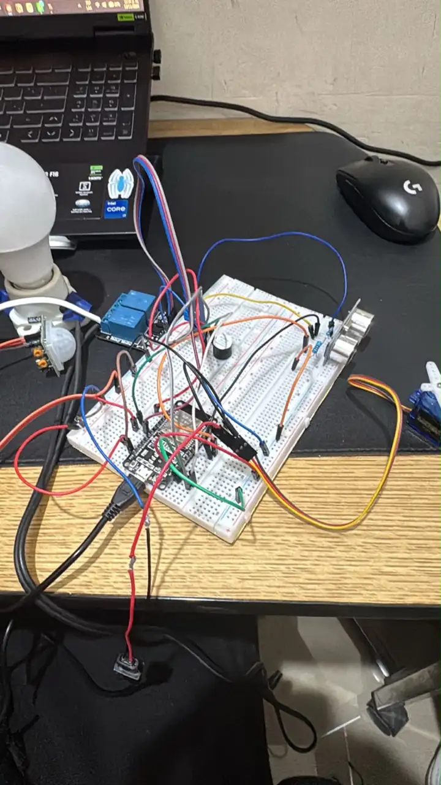

# SafeDrop — Evidencias del prototipo

Esta carpeta conserva las fotografias y capturas reales del montaje.

## Aviso de seguridad solicitado por la maestra

**La fotografia original muestra conductores de un foco de red domestica
hacia el rele sobre la mesa. Esa parte debe permanecer desconectada de
la corriente de pared. Para las pruebas, la demostracion y el video,
usar iluminacion de bajo voltaje (por ejemplo una tira LED de 12 V)
con fuente apropiada. Si se usa 127 V, debe estar en una caja cerrada,
aislada y separada de la protoboard.**

## Fotografia del montaje de pruebas

Este archivo documenta un prototipo inicial, no la carcasa final.

## Evidencias por agregar

- `broker_mqtt.png`: captura real de `mosquitto_sub -h localhost -t "safedrop/#" -v`.
- Fotografia de la celda HX711 instalada y calibrada.
- Captura de la interfaz web de la camara ESP32-S3.
- Foto de jumpers cortos identificados por color (rojo +, negro GND,
  otros colores senal), cables agrupados y ESP32 visible.
- Fotografias de la carcasa definitiva y de la demostracion completa.

No subir contrasenas, codigos QR activos ni otros secretos al repositorio.
